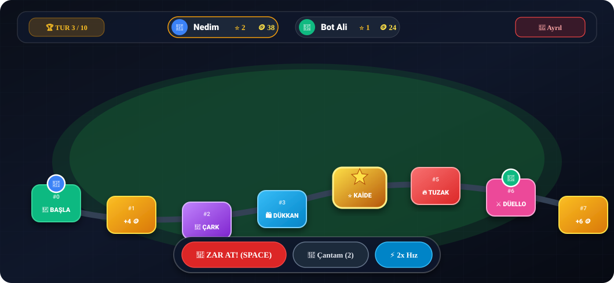

  

  
  
  
  
  

  <strong>Dil Seçimi / Select Documentation Language:</strong> 
  <a href="#-türkçe-dokümantasyon">🇹🇷 Türkçe</a> •
  <a href="#-english-documentation">🇬🇧 English</a> •
  <a href="#-deutsche-kurzanleitung">🇩🇪 Deutsch</a> •
  <a href="#-guía-rápida-en-español">🇪🇸 Español</a> •
  <a href="#-guide-rapide-en-français">🇫🇷 Français</a>

---

  

---

## 🇹🇷 Türkçe Dokümantasyon

**Parti Dünyası (PartyCraft: Wonder Board)**; İstanbul, Tokyo, Paris ve New York sokaklarında arkadaşlarınızla veya akıllı yapay zeka botlarıyla oynayabileceğiniz; sevimli Lego tarzı görsel tasarımı, canlı harita animasyonları, taktik kartları ve 6 adet zengin mini oyunu olan **sıra tabanlı çok oyunculu masa oyunudur**.

### 🌟 Öne Çıkan Özellikler
- ⚡ **Tek Dosya ile Anında Kurulum (Ultra Zero-Setup):**
  - PHP sunucular için tek dosya: **`index.php`** (Çok oyunculu arka uç + tam oyun arayüzü tek dosyada!).
  - Statik / GitHub Pages / Çevrimdışı kullanım için tek dosya: **`index.html`** (Sıfır bağımlılık).
- 🌐 **Otomatik Dil Algılama (5 Dil Desteği):**
  - **Amerikan / İngiliz tarayıcı ile girenler oyunu otomatik olarak İngilizce görür!**
  - Türkçe (🇹🇷), İngilizce (🇬🇧), Almanca (🇩🇪), İspanyolca (🇪🇸) ve Fransızca (🇫🇷) dilleri tam desteklidir.
  - Sayfa yenilemeden tek tıkla dil değiştirilebilir.
- 🎮 **6 Heyecan Verici Mini Oyun:**
  1. 🪙 **Altın Toplama Sepeti (Coin Catcher):** Sağa-sola hareketli sepetle gökten düşen altınları topla (mobil zoom korumalı).
  2. 🎯 **Refleks Hedefleri (Reflex Pop):** Ekranda aniden beliren hedefleri kaçırmadan en hızlı sürede vur.
  3. 🎈 **Balon Patlatma (Balloon Mash):** Süre dolmadan ekrandaki balona hızlıca tıklayarak şişir ve patlat.
  4. 🎁 **Şans Sandıkları (Lucky Chests):** 3 gizemli sandıktan en büyük ödülü saklayanı tahmin et.
  5. 🧠 **Hafıza Matrisi (Memory Matrix):** Yanıp sönen renkli karo kombinasyonunu aklında tut ve doğru sırayla dokun.
  6. 🔨 **Güç Çekici & Hassas Zamanlama (Timing Hammer):** Salınan güç barını tam merkezdeki %100 hedefte durdur, çanı çaldır!

  

### 🎒 Taktik Eşyaları (Çanta)
- 🎲 **Çift Zar:** Sonraki turda 2 zar birden atarsınız (2 - 12 adım).
- 🚀 **Süper Roket:** Hedefe doğru direkt olarak 7 adım ileri fırlar.
- 🛡️ **Manyetik Kalkan:** Tuzaklara ve altın çalma hamlelerine karşı 2 tur tam koruma sağlar.
- 🧲 **Yıldız Mıknatısı:** Yıldız kaidesini haritada 3 adım kendinize doğru çeker.
- 🔄 **Takas Işınlanması:** Seçilen bir rakip ile haritadaki konumlarınızı takas eder.
- 👻 **Hayalet Pelerin:** 2 tur boyunca tüm karo tuzaklarından ve cezalardan muaf olursunuz.
- 🍀 **Şanslı Altın Zar:** Sonraki zarınız kesinlikle 6 (çift zarda 12) gelir!

### 🚀 Sunucunuza Nasıl Yüklersiniz? (Sadece 1 Dosya!)
1. Hostinginize (cPanel, Plesk, Apache, Nginx vb.) **SADECE `index.php`** dosyasını yükleyin.
2. Tarayıcınızda açın (`https://siteniz.com/`).
3. **Bitti!** Çok oyunculu oda kurma, QR kodla davet etme ve arkadaş bağlantıları otomatik aktifleşir.

---

## 🇬🇧 English Documentation

**PartyCraft: Wonder Board** is a vibrant, zero-dependency turn-based multiplayer board game celebrating world cities (Istanbul, Tokyo, Paris, and New York) with interactive board tiles, tactical items, and 6 competitive mini-games.

### 🌟 Key Highlights
- ⚡ **Single-File Zero-Setup Architecture:**
  - For PHP Web Hosting: Upload **ONLY `index.php`** (serves the entire game UI and handles multiplayer rooms via atomic JSON locking).
  - For Static / GitHub Pages / Offline: Upload **`index.html`** (runs 100% offline with AI bots).
- 🌐 **Automatic Geolocation / Locale Language Detection:**
  - When a user enters the site from the **US, UK, or international locations**, the game **automatically opens in English**!
  - Supports 5 languages: 🇬🇧 English, 🇹🇷 Turkish, 🇩🇪 German, 🇪🇸 Spanish, and 🇫🇷 French.
  - Can be switched at any time with one click from the header.
- 🎮 **6 Competitive Mini-Games:**
  1. 🪙 **Coin Catcher:** Catch falling gold with a mobile-friendly basket.
  2. 🎯 **Reflex Pop:** Hit rapidly popping targets before they vanish.
  3. 🎈 **Balloon Mash:** Rapid-click to inflate and pop the party balloon.
  4. 🎁 **Lucky Chests:** Pick the chest hiding the grand treasure.
  5. 🧠 **Memory Matrix:** Remember and repeat the glowing tile sequence.
  6. 🔨 **Timing Hammer (Power Striker):** Stop the oscillating power gauge at 100% bullseye to ring the bell and win +15 Gold!

### 🎒 Tactical Items
- 🎲 **Double Dice:** Roll two dice on your next turn (2 - 12 steps).
- 🚀 **Super Rocket:** Launch 7 tiles forward instantly.
- 🛡️ **Magnetic Shield:** Complete protection from traps and coin steals for 2 turns.
- 🧲 **Star Magnet:** Pull the Star Kaide 3 tiles closer to your pawn.
- 🔄 **Swap Warp:** Swap board positions with any chosen rival.
- 👻 **Ghost Cloak:** Immune to all traps, hazards, and penalties for 2 turns.
- 🍀 **Lucky Die:** Guarantees your next roll is a max 6 (or 12 with Double Dice).

### 🚀 Quick 1-Minute Deployment
1. Upload **`index.php`** to your web server (`public_html/` or a subfolder).
2. Visit `https://your-domain.com/`.
3. Done! Instant multiplayer room creation, QR code sharing, and invite URLs (`?room=ABCD42`).

---

## 🇩🇪 Deutsche Kurzanleitung

**PartyCraft: Wonder Board** ist ein rundenbasiertes Mehrspieler-Brettspiel mit 6 Minispielen, taktischen Gegenständen und 5 Sprachen.

- ⚡ **Einzeldatei-Bereitstellung:** Laden Sie einfach **`index.php`** auf Ihren Webserver hoch. Keine Datenbank und kein npm erforderlich!
- 🌐 **Automatische Spracherkennung:** Browser auf Deutsch schalten das Spiel automatisch auf Deutsch.
- 🎮 **6 Minispiele:** Münzfang, Reflex-Ziele, Ballonplatzen, Schatztruhen, Gedächtnismatrix und der neue Kraft-Hammer!

---

## 🇪🇸 Guía Rápida en Español

**PartyCraft: Wonder Board** es un juego de mesa multijugador por turnos ambientado en ciudades del mundo con 6 minijuegos y objetos tácticos.

- ⚡ **Instalación en un Solo Archivo:** Sube únicamente **`index.php`** a tu servidor web. ¡Sin base de datos ni configuraciones complejas!
- 🌐 **Detección Automática de Idioma:** Los navegadores en español cargan la interfaz en español automáticamente.
- 🎮 **6 Minijuegos:** Atrapa-monedas, Reflejos, Globos, Cofres de la Suerte, Matriz de Memoria y Martillo de Fuerza.

---

## 🇫🇷 Guide Rapide en Français

**PartyCraft: Wonder Board** est un jeu de plateau multijoueur au tour par tour avec 6 mini-jeux et des objets tactiques.

- ⚡ **Déploiement en un Seul Fichier:** Téléversez uniquement **`index.php`** sur votre hébergeur web.
- 🌐 **Détection Automatique de la Langue:** L'interface bascule automatiquement en français si votre navigateur est configuré en français.
- 🎮 **6 Mini-Jeux:** Attrape-Pièces, Réflexes, Éclate-Ballon, Coffres aux Trésors, Matrice de Mémoire et Marteau Forain!

---

## 📜 Lisans / License

- **Developer:** Nedim Demir
- **License:** [MIT License](LICENSE) - Open source, free to use, modify, and host on your own websites.
