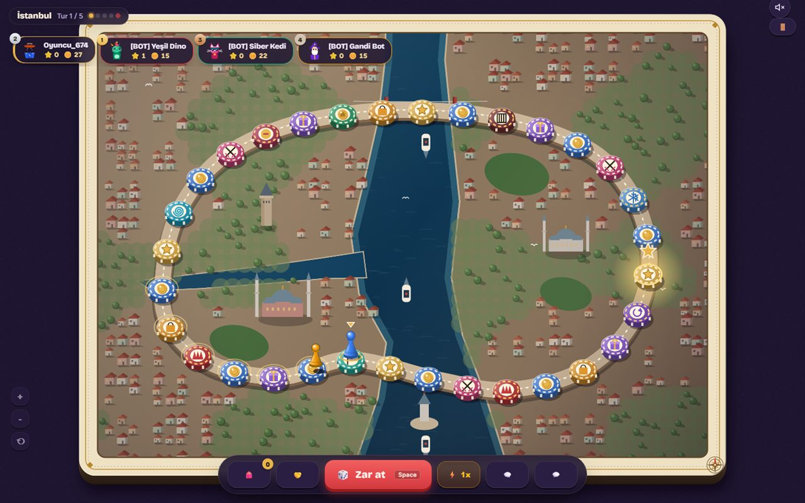
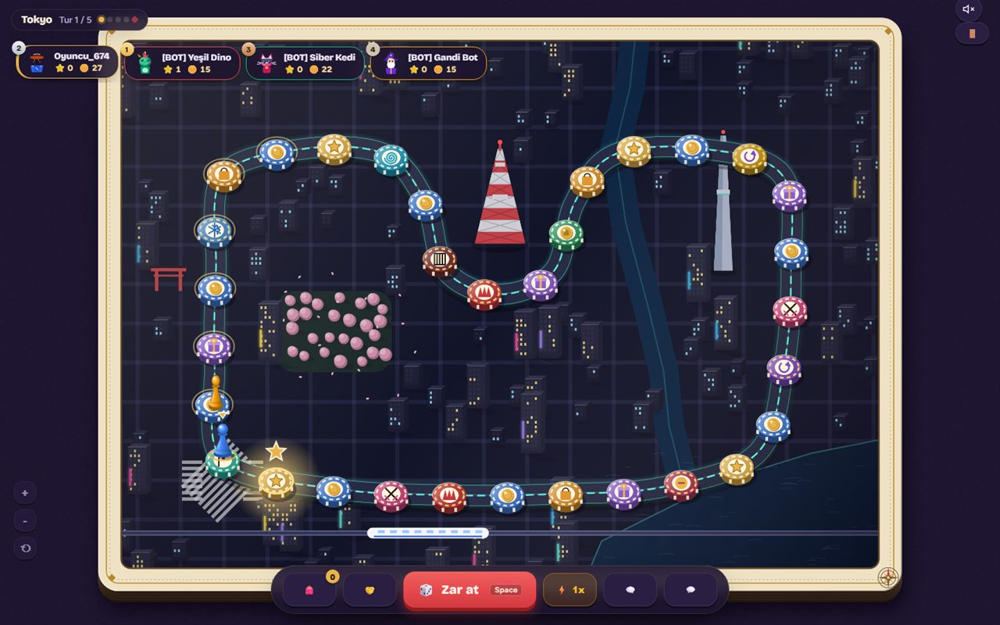
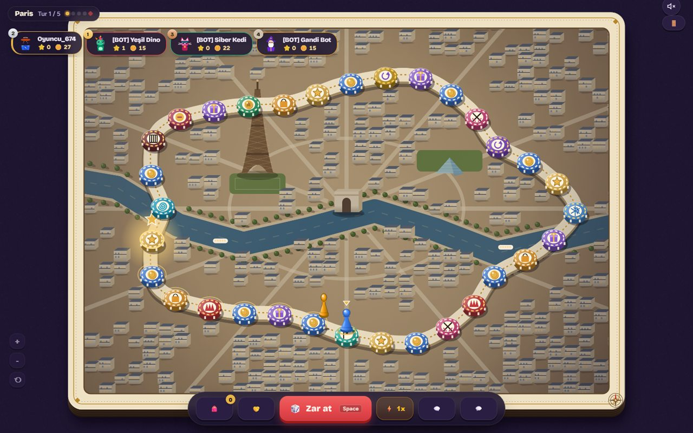
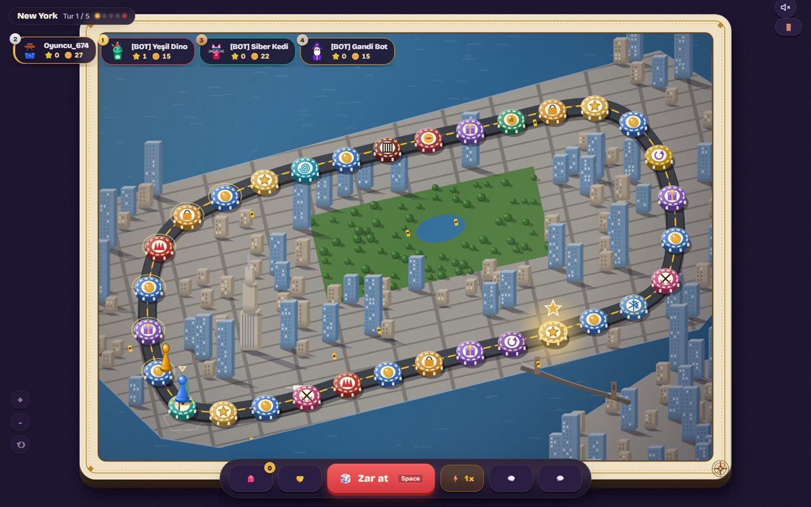
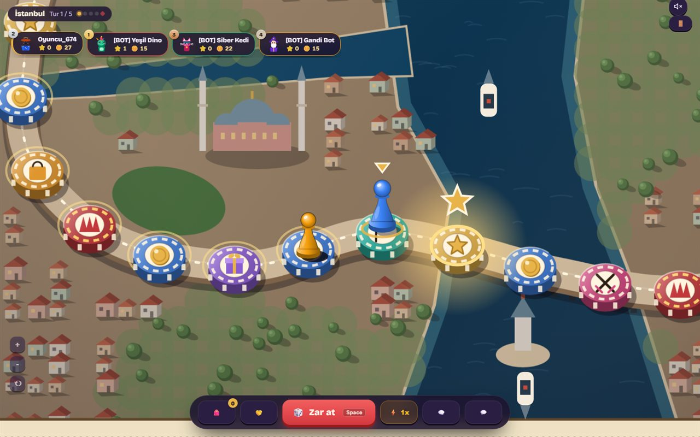

<h1 align="center">Parti Dünyası</h1>

<p align="center">
  <strong>İstanbul, Tokyo, Paris ve New York'ta geçen, tarayıcıda oynanan parti masa oyunu.</strong><br>
  Zar at, altın topla, yıldızları kap, mini oyunlarda rakiplerini geç.
</p>

<p align="center">
  <a href="https://nedimdmir.github.io/board_game/"><strong>▶ Hemen oyna</strong></a> ·
  <a href="https://github.com/nedimdmir/board_game/releases/latest">Son sürümü indir</a> ·
  <a href="#english">English</a>
</p>

<p align="center">
  
</p>

## Neler var?

- **Dört şehir, dört ayrı tahta.** Her şehrin kendi pist şekli ve haritası var: Boğaz'ı köprüden geçen İstanbul, neon ışıklı Tokyo, bulvarları yıldız gibi açılan Paris ve Central Park'ı dolaşan New York.
- **Gerçek bir masa oyunu hissi.** Harita keçe masanın üstünde duran kalın bir tahta; kareler poker fişi gibi, karakterler klasik piyonlar. Zar 3D olarak yuvarlanıyor.
- **8 taktik eşya.** Çift Zar, Süper Roket, Manyetik Kalkan, Altın Mıknatısı, Muz Kabuğu, Takas Asası, Hayalet Pelerin ve Şanslı Altın Zar.
- **6 mini oyun.** Her turun sonunda: Altın Yağmuru, Refleks, Balon Şişirme, Hazine Sandıkları, Hafıza Matrisi ve Güç Çekici.
- **Arkadaşlarla veya botlarla.** Oda kur, kodu ya da QR'ı paylaş; boş koltukları akıllı botlar doldurur. İnternetsiz de oynanır.
- **5 dil.** Türkçe, İngilizce, Almanca, İspanyolca ve Fransızca; tarayıcının diline göre kendiliğinden açılır.
- **Kurulum gerektirmez.** Tek bir `index.html` ya da `index.php` dosyası yeterli; veritabanı, npm veya CDN gerekmez.

<table>
  <tr>
    <td></td>
    <td></td>
  </tr>
  <tr>
    <td></td>
    <td></td>
  </tr>
</table>

## Nasıl oynanır?

1. Sıran gelince **Zar at**'a bas (klavyede Boşluk tuşu). Piyonun o kadar kare ilerler.
2. Durduğun karenin etkisi uygulanır: altın kazanırsın, dükkâna girersin, tuzağa düşersin, düelloya girersin…
3. Parlayan **yıldız karesinden** geçerken 20 altının varsa bir yıldız alırsın.
4. Her turun sonunda herkes aynı mini oyunu oynar; ilk sıralar altın ve eşya kazanır.
5. Son turdan sonra **en çok yıldızı** olan kazanır. Eşitlikte altın sayısı belirler.

Eşyalarını kendi sıranda, zar atmadan önce **Çantam**'dan kullanırsın.

## Oyunu yayınlamak

| Nereye? | Hangi dosya? | Ne olur? |
| :-- | :-- | :-- |
| GitHub Pages, Netlify gibi statik barındırma | `index.html` | Botlarla oynanır, internetsiz de çalışır. |
| PHP destekli herhangi bir hosting | `index.php` | Çok oyunculu odalar, davet bağlantısı ve QR kod açılır. Tek dosya yeter. |
| Kendi bilgisayarın | `index.html` | Dosyaya çift tıkla, botlarla oyna. |

Ayrıntılı rehber: [DEPLOYMENT.md](DEPLOYMENT.md)

## Geliştirme

Kaynak dosyalar `public/` klasöründe. `index.html` ve `index.php` bu dosyalardan üretilir:

```bash
node build-single-file.js
```

| Dosya | Görevi |
| :-- | :-- |
| `public/js/world-maps.js` | Şehir tahtaları, pistler, kareler ve piyonlar |
| `public/js/fx.js` | 3D zar, konfeti ve arayüz efektleri |
| `public/css/premium.css` | Oyunun görsel teması |
| `api.php` | Çok oyunculu oyun sunucusu (PHP) |
| `server.js` | Çevrimdışı oyun motoru (ve isteğe bağlı Node sunucusu) |

## Teşekkürler

- [GSAP](https://gsap.com) — animasyonlar (standart ücretsiz lisans)
- [canvas-confetti](https://github.com/catdad/canvas-confetti) — konfeti (ISC)
- [Bricolage Grotesque](https://fonts.google.com/specimen/Bricolage+Grotesque) ve [Figtree](https://fonts.google.com/specimen/Figtree) — yazı tipleri (SIL Open Font License)

Lisans metinleri `public/vendor/licenses/` klasöründe.

## Lisans

[MIT](LICENSE) © Nedim Demir

---

<h2 id="english">English</h2>

**Parti Dünyası** (PartyCraft: Wonder Board) is a browser party board game set in İstanbul, Tokyo, Paris and New York. Roll the dice, collect coins, buy stars and beat your rivals in mini-games.

**[▶ Play now](https://nedimdmir.github.io/board_game/)** · [Download the latest release](https://github.com/nedimdmir/board_game/releases/latest)

- **Four cities, four boards**, each with its own track shape and illustrated map, presented as a physical board on a felt table with chip-style spaces and classic pawns.
- **8 tactical items** and **6 mini-games** played at the end of every round.
- **Play with friends or bots.** Create a room and share the code or QR; empty seats are filled by bots. Works offline too.
- **5 languages** (TR, EN, DE, ES, FR), picked automatically from your browser.
- **Zero setup.** Upload a single `index.html` (static hosting, bots only) or `index.php` (any PHP host, full multiplayer). No database, npm or CDN needed.

**How to play:** roll on your turn, land on a space and take its effect, buy a star for 20 coins when you pass the glowing star space, play the end-of-round mini-game. Most stars after the last round wins; coins break ties.

**Build:** sources live in `public/`; run `node build-single-file.js` to regenerate `index.html` and `index.php`.

Licensed under [MIT](LICENSE).
