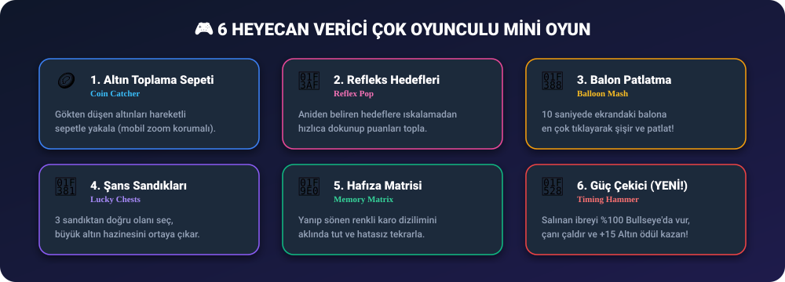

# 🎲 PartyCraft: Wonder Board

<p align="center">
  
</p>

<p align="center">
  <a href="https://img.shields.io/static/v1?label=Languages&message=EN%20%7C%20TR%20%7C%20DE%20%7C%20ES%20%7C%20FR&color=0284c7"></a>
  <a href="https://img.shields.io/static/v1?label=Architecture&message=Single-File%20(index.php%20%2F%20index.html)&color=10b981"></a>
  <a href="https://img.shields.io/static/v1?label=Dependencies&message=Zero%20NPM%20%2F%20Vanilla%20JS&color=059669"></a>
  <a href="https://img.shields.io/static/v1?label=Platform&message=Web%20%7C%20Mobile%20%7C%20Desktop&color=8b5cf6"></a>
  <a href="https://img.shields.io/static/v1?label=License&message=MIT&color=f59e0b"></a>
</p>

---

**PartyCraft: Wonder Board** is a vibrant, zero-dependency turn-based multiplayer board game celebrating world cities (Istanbul, Tokyo, Paris, and New York) with interactive board tiles, tactical items, and 6 competitive mini-games.

<p align="center">
  
</p>

## 🌟 Key Highlights

- ⚡ **Ultra Zero-Setup Single-File Deployment:**
  - **Option 1 (PHP Web Hosting):** Upload **ONLY `index.php`** to your web server. It delivers both the web client and manages multiplayer room synchronization via atomic JSON files. No database or npm setup required!
  - **Option 2 (Static Hosting / GitHub Pages):** Upload **`index.html`** for 100% serverless offline play with smart AI bots.
- 🌐 **Automatic Geolocation / Language Detection:**
  - Visitors from the **United States, United Kingdom, or international locations** immediately see the game in **English**!
  - Full support for 5 languages: 🇬🇧 English, 🇹🇷 Turkish, 🇩🇪 German, 🇪🇸 Spanish, and 🇫🇷 French.
  - One-click language switching from the top header or settings menu.
- 🎮 **6 Competitive Mini-Games:**
  1. 🪙 **Coin Catcher:** Catch falling gold with your basket (mobile double-tap zoom protected).
  2. 🎯 **Reflex Pop:** Hit rapidly popping targets before they vanish.
  3. 🎈 **Balloon Mash:** Rapid-click to inflate and pop the party balloon.
  4. 🎁 **Lucky Chests:** Pick the chest hiding the grand treasure.
  5. 🧠 **Memory Matrix:** Remember and repeat the glowing tile sequence.
  6. 🔨 **Timing Hammer (Power Striker):** Stop the oscillating power gauge at 100% bullseye to ring the bell and win +15 Gold!

<p align="center">
  
</p>

## 🎒 Tactical Items

| Item | Icon | Effect |
| :--- | :---: | :--- |
| **Double Dice** | 🎲 | Roll two dice on your next turn (2 - 12 steps). |
| **Super Rocket** | 🚀 | Launch 7 tiles forward instantly. |
| **Magnetic Shield** | 🛡️ | Complete protection from traps and coin steals for 2 turns. |
| **Star Magnet** | 🧲 | Pull the Star Kaide 3 tiles closer to your pawn. |
| **Swap Warp** | 🔄 | Swap board positions with any chosen rival. |
| **Ghost Cloak** *(New!)* | 👻 | Immune to all traps, hazards, and penalties for 2 turns. |
| **Lucky Die** *(New!)* | 🍀 | Guarantees your next roll is a max 6 (or 12 with Double Dice). |

## 🚀 How to Deploy to Your Website (Single File!)

```text
📁 Your Web Root (e.g. public_html/ or public_html/party/)
└── 📄 index.php   <-- UPLOAD ONLY THIS SINGLE FILE!
```

1. Upload **`index.php`** to your web hosting via FTP or cPanel File Manager.
2. Visit `https://your-domain.com/` in any browser.
3. You're live! Room codes, QR code invitations, and multiplayer synchronization work immediately.

## 🕹️ Controls

- **Desktop (PC / Mac):**
  - **Roll Dice:** Click button or press <kbd>SPACE</kbd>.
  - **Inventory:** Press <kbd>I</kbd>.
  - **Camera:** Click and drag to pan, scroll wheel to zoom.
- **Mobile & Tablet:**
  - Touch to drag, pinch to zoom.
  - Ergonomic bottom action dock.

## 📜 License

- **Developer:** Nedim Demir
- **License:** [MIT License](LICENSE)
